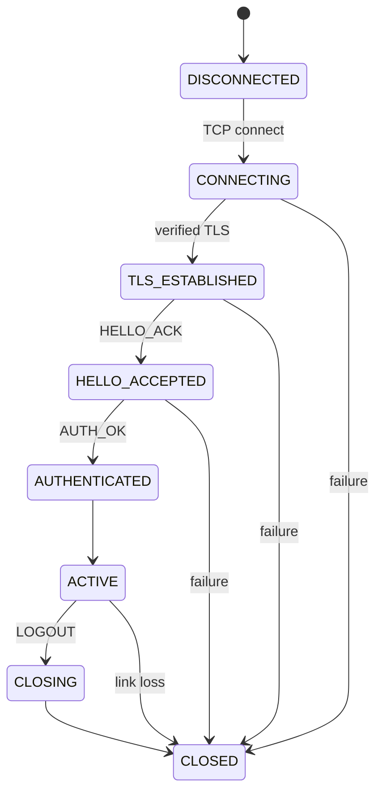
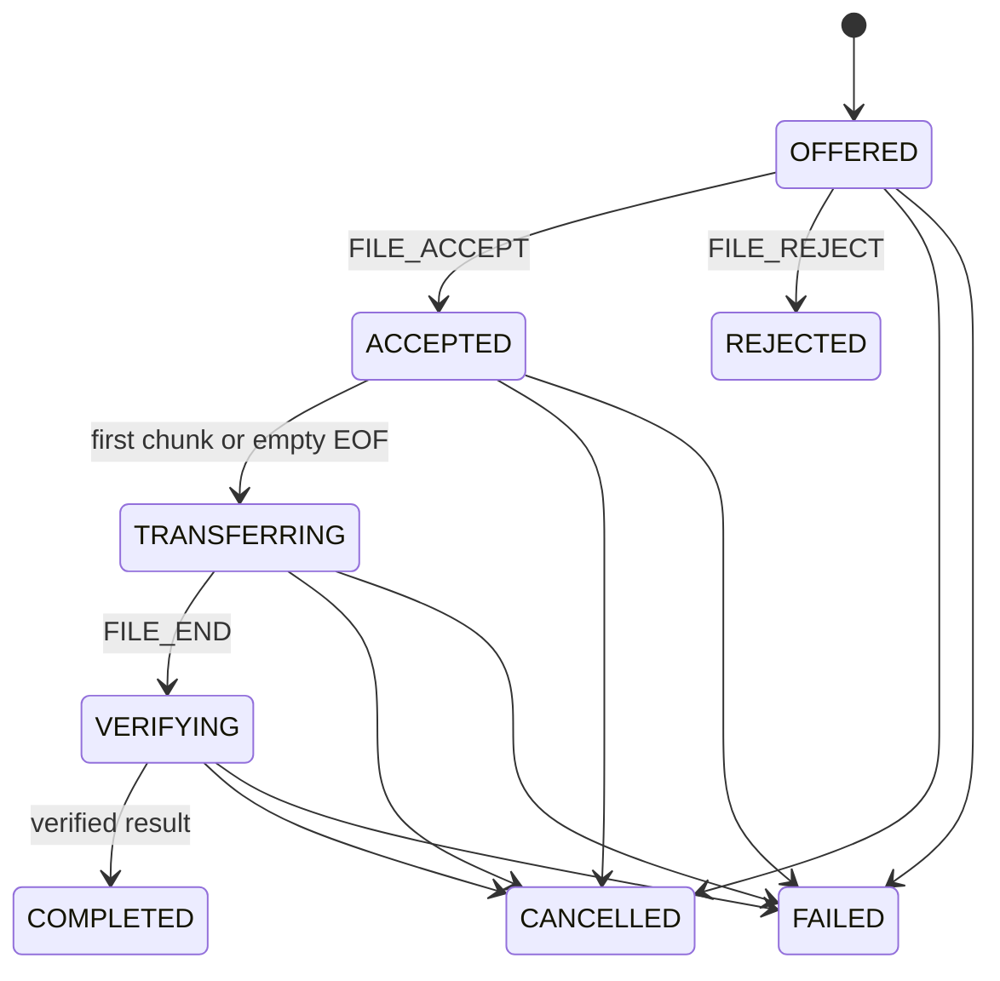
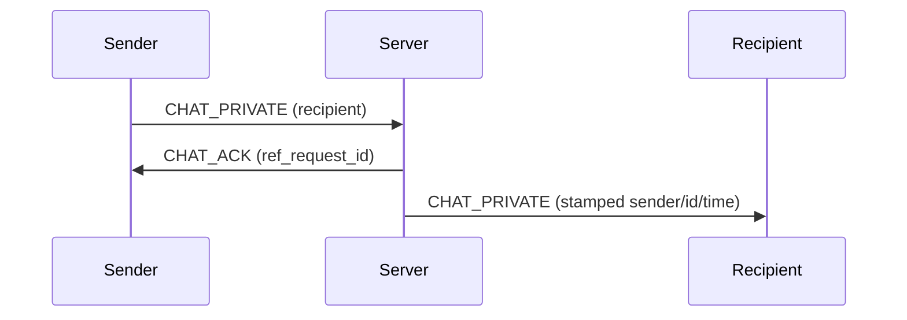
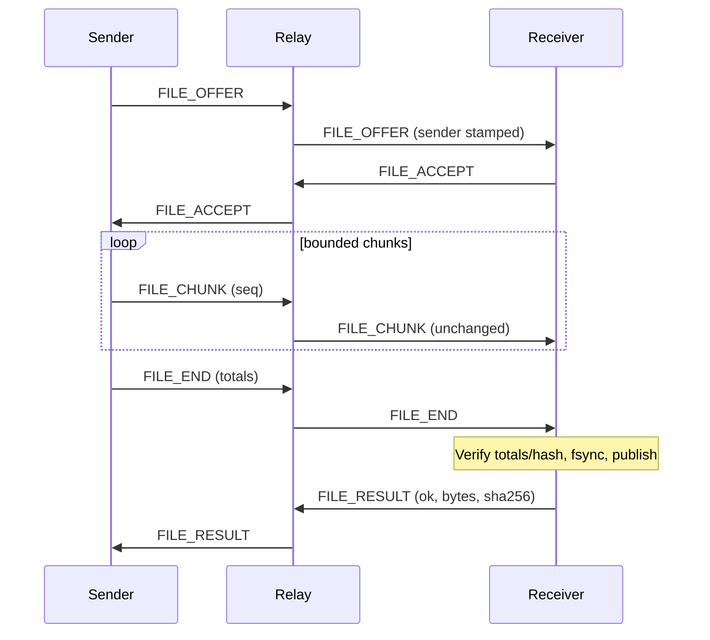
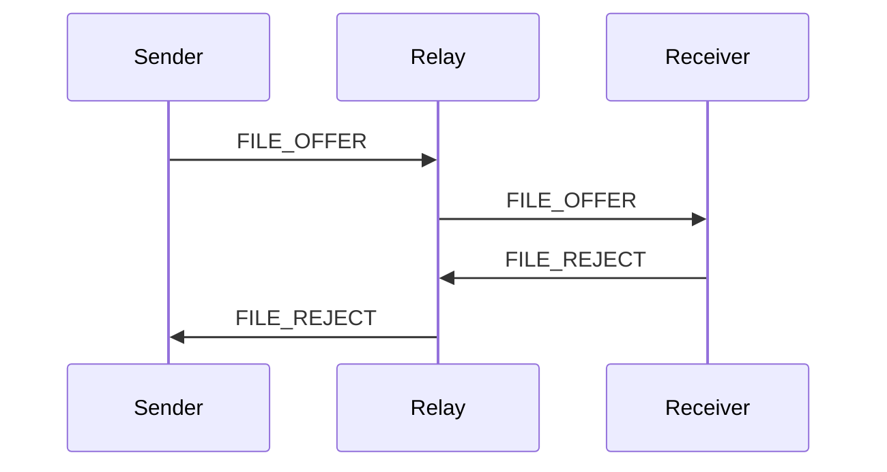
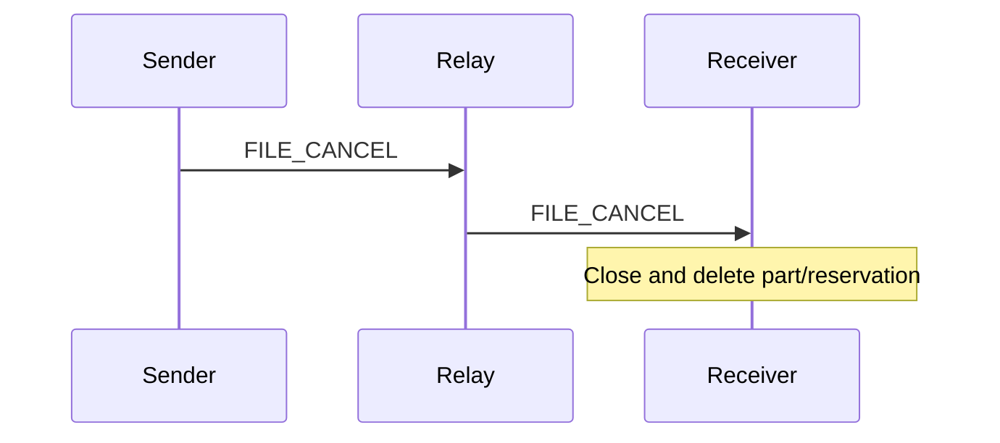
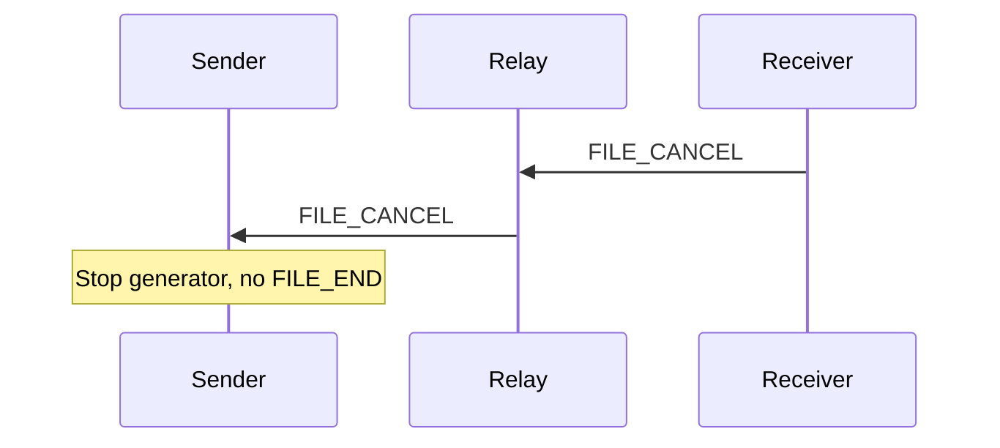
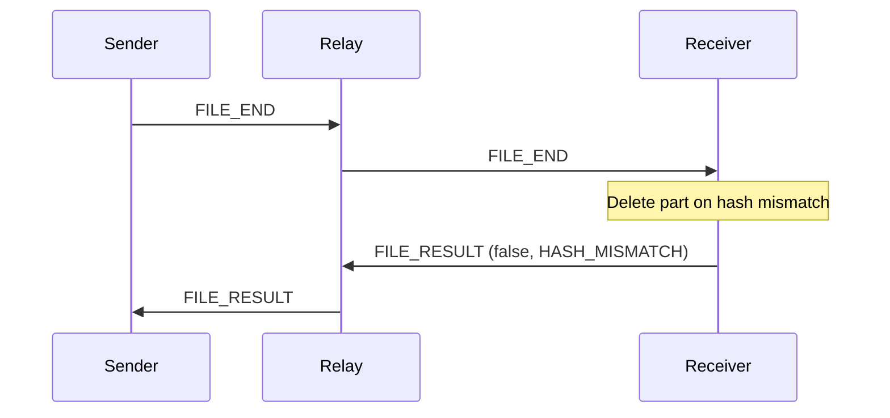
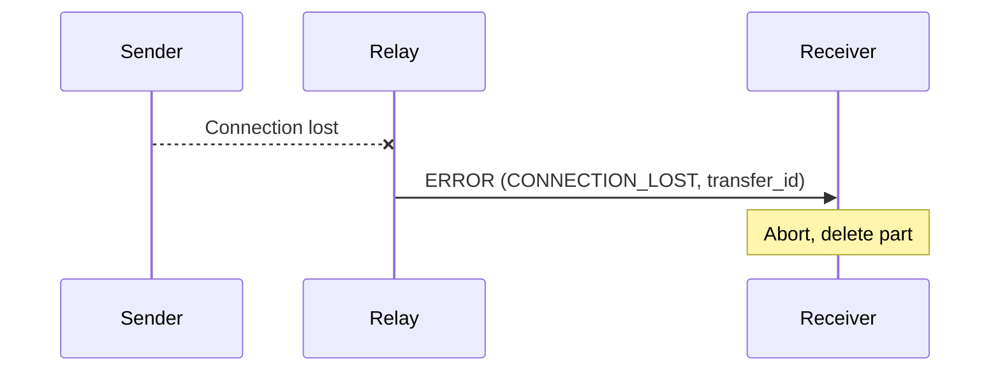
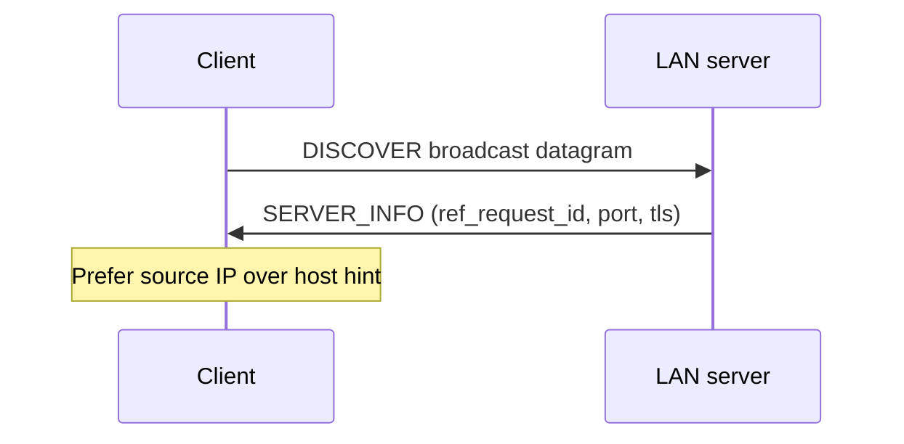

# LanLink Protocol v1

## Purpose and scope

C's shared contract for A (server/transport) and B (client/service/Qt bridge).
TCP with verified TLS carries auth, chat and server-relayed files. UDP carries
discovery only. Chat/file operations are forbidden before authentication.
Python 3.10+; codec and models have no socket, TLS, disk or Qt dependencies.

## Frame diagram

```text
4 bytes uint32 BE       H bytes                 P bytes
+---------------------+-----------------------+---------------------+
| H = header length   | UTF-8 JSON object      | payload             |
+---------------------+-----------------------+---------------------+
P = header.payload_length, in bytes, never Unicode characters
```

Serialise with `json.dumps(h, ensure_ascii=False, separators=(",", ":"),
sort_keys=True)`. Reject duplicate keys, NaN/Infinity, non-objects, invalid UTF-8,
lone surrogates, bool/float in integer fields and integers outside 0..2^63-1.
Unknown fields are errors. Never resynchronise a corrupt TCP stream.

## Limits

These are application limits, not TCP limits. HELLO_ACK publishes the complete
ProtocolLimits object. Missing/unknown fields are rejected. Values are positive
integers, not bool. idle_timeout_s must exceed heartbeat_interval_s.

| Key | Default | Hard ceiling |
|---|---:|---:|
| max_header_bytes | 16384 | 1048576 |
| max_chunk_bytes | 65536 | 1048576 |
| max_file_bytes | 104857600 | 2^63-1 |
| max_chat_bytes | 8192 | 1048576 |
| max_user_list_bytes | 65536 | 1048576 |
| max_datagram_bytes | 1024 | 65507 |
| heartbeat_interval_s | 15 | 86400 |
| idle_timeout_s | 45 | 86400 |

## Common header

Every message: version (integer 1), type (catalogue value), request_id (1..64
ASCII letters/digits/underscore/hyphen), payload_length (nonnegative integer
bounded per type). Builders generate uuid4().hex request IDs. Encoding supplies
version/length when absent and validates them when present.
All header strings are nonempty, strict UTF-8 and control-free. Usernames and
recipients: 1..32, no whitespace. Message/reference IDs use request-ID syntax.
Server names: ≤64 characters, host hints: ≤255. Timestamps: integer milliseconds.
Client headers containing sender/message_id/timestamp_ms yield SPOOFED_FIELD.

## Full message catalogue

C = client to server; S = server to client; ? = optional. Other fields are
required. All payloads are empty unless explicitly stated.

| Type | Direction | Extra header fields | Payload |
|---|---|---|---|
| HELLO | C | client_name ≤64, client_version ≤32 | empty |
| HELLO_ACK | S | ref_request_id, server_name ≤64, limits | empty |
| AUTH | C | username | strict UTF-8 password, 1..256 bytes |
| AUTH_OK | S | ref_request_id, username | empty |
| USER_LIST | C/S | C none; S ref_request_id | C empty; S JSON users object |
| LOGOUT | C/S | reason? ≤128 | empty |
| ERROR | S | code, message ≤256, ref_request_id?, field? ≤64, transfer_id? | empty |
| CHAT_PUBLIC | C | none | strict UTF-8, 1..max_chat_bytes |
| CHAT_PUBLIC | S | message_id, sender, timestamp_ms | same |
| CHAT_PRIVATE | C | recipient | same |
| CHAT_PRIVATE | S | message_id, sender, recipient, timestamp_ms | same |
| CHAT_ACK | S | ref_request_id, message_id, timestamp_ms, status="accepted" | empty |
| FILE_OFFER | C | transfer_id, recipient, filename, size, sha256, chunk_size | empty |
| FILE_OFFER | S | same plus sender | empty |
| FILE_ACCEPT | C/S | transfer_id | empty |
| FILE_REJECT | C/S | transfer_id, reason? ≤128 | empty |
| FILE_CHUNK | C/S | transfer_id, seq ≥0 | raw bytes, 1..max_chunk_bytes |
| FILE_END | C/S | transfer_id, total_chunks ≥0, total_bytes ≥0 | empty |
| FILE_RESULT | C/S | transfer_id, ok:bool, received_bytes, sha256?, error_code iff !ok | empty |
| FILE_CANCEL | C/S | transfer_id, reason?:ErrorCode | empty |
| PING | C/S | none | empty |
| PONG | C/S | ref_request_id | empty |
| DISCOVER | UDP request | none | empty |
| SERVER_INFO | UDP reply | ref_request_id, server_name, port:1..65535, tls:bool, host? | empty |

transfer_id is 32 lowercase hex; sha256 is 64 lowercase hex. Size and byte totals
are ≤max_file_bytes; chunk_size is 1..max_chunk_bytes. Filename: 1..255 UTF-8
bytes, bare name, not ./.., no slash/backslash/control. Receiver additionally
normalises NFC, replaces Unicode format controls (Cf) and Windows-forbidden
characters, neutralises Windows device names (including COM/LPT superscript
digits), and rejects drive-qualified names such as C:x. Wire validation is
intentionally stricter on length but does not perform this platform sanitising;
failed acceptance is reported as a business error before any part is created.

USER_LIST is exactly `{"users":[{"username":"an","online":true,"ip":null,
"port":null}]}`. Entries have exactly these keys. ip is null or IPv4/IPv6
literal; port null or 1..65535. Empty list allowed; duplicate usernames rejected.
CHAT_ACK means accepted for processing, not delivered/read. No read receipts.
AUTH payloads are never logged; Message repr omits all payload bytes.

## Worked examples and golden frames

The committed fixture bytes are independently reproducible with bare struct + json.dumps (test_golden_bytes_are_independently_reproducible). Historical generation provenance was not retained; reproducibility is verified, provenance is not claimed. Each hex dump includes the four-byte prefix, header and payload. Changing one requires explicit contract review.

### HELLO

Header:
```json
{
  "version": 1,
  "request_id": "r1",
  "type": "HELLO",
  "payload_length": 0,
  "client_name": "LanLink",
  "client_version": "1.0"
}
```

Payload: `(empty)`.

Full frame hex:
```text
000000707b22636c69656e745f6e616d65223a224c616e4c696e6b222c22636c69656e745f76657273696f6e223a22312e30222c227061796c6f61645f6c656e677468223a302c22726571756573745f6964223a227231222c2274797065223a2248454c4c4f222c2276657273696f6e223a317d
```

### CHAT_PRIVATE

Header:
```json
{
  "version": 1,
  "request_id": "r1",
  "type": "CHAT_PRIVATE",
  "payload_length": 18,
  "recipient": "binh"
}
```

Payload: `👨‍👩‍👧`.

Full frame hex:
```text
0000005c7b227061796c6f61645f6c656e677468223a31382c22726563697069656e74223a2262696e68222c22726571756573745f6964223a227231222c2274797065223a22434841545f50524956415445222c2276657273696f6e223a317df09f91a8e2808df09f91a9e2808df09f91a7
```

### FILE_OFFER

Header:
```json
{
  "version": 1,
  "request_id": "r1",
  "type": "FILE_OFFER",
  "payload_length": 0,
  "transfer_id": "0123456789abcdef0123456789abcdef",
  "recipient": "binh",
  "filename": "Báo cáo.pdf",
  "size": 0,
  "sha256": "e3b0c44298fc1c149afbf4c8996fb92427ae41e4649b934ca495991b7852b855",
  "chunk_size": 65536
}
```

Payload: `(empty)`.

Full frame hex:
```text
0000010d7b226368756e6b5f73697a65223a36353533362c2266696c656e616d65223a2242c3a16f2063c3a16f2e706466222c227061796c6f61645f6c656e677468223a302c22726563697069656e74223a2262696e68222c22726571756573745f6964223a227231222c22736861323536223a2265336230633434323938666331633134396166626634633839393666623932343237616534316534363439623933346361343935393931623738353262383535222c2273697a65223a302c227472616e736665725f6964223a223031323334353637383961626364656630313233343536373839616263646566222c2274797065223a2246494c455f4f46464552222c2276657273696f6e223a317d
```

### FILE_CHUNK

Header:
```json
{
  "version": 1,
  "request_id": "r1",
  "type": "FILE_CHUNK",
  "payload_length": 3,
  "transfer_id": "0123456789abcdef0123456789abcdef",
  "seq": 0
}
```

Payload: `616263` (hex).

Full frame hex:
```text
0000007f7b227061796c6f61645f6c656e677468223a332c22726571756573745f6964223a227231222c22736571223a302c227472616e736665725f6964223a223031323334353637383961626364656630313233343536373839616263646566222c2274797065223a2246494c455f4348554e4b222c2276657273696f6e223a317d616263
```

## Error codes

ProtocolError and TransferError expose `.code` and `.message`. The Vietnamese text below comes from the central USER_MESSAGES table; no exception contains a password. A must implement ERROR for router/session failures, the receiver sends FILE_RESULT for write/verification failures, and sender source failures travel as FILE_CANCEL. Ingress framing errors normally close the connection after a best-effort ERROR.

| Code | Meaning | Actual raiser / planned emitter | Carrier / local outcome | Vietnamese user message |
|---|---|---|---|---|
| BAD_FRAME | Zero or invalid frame prefix/container | codec; engines propagate validated input errors | connection close; best-effort ERROR by A transport (planned); engine failure FILE_RESULT / FILE_CANCEL | Khung dữ liệu không hợp lệ. |
| HEADER_TOO_LARGE | Header byte count exceeds negotiated limit | codec; engines propagate validated input errors | connection close; best-effort ERROR by A transport (planned); engine failure FILE_RESULT / FILE_CANCEL | Phần đầu dữ liệu quá lớn. |
| PAYLOAD_TOO_LARGE | Declared payload/datagram exceeds per-type negotiated limit | codec; engines propagate validated input errors | connection close; best-effort ERROR by A transport (planned); engine failure FILE_RESULT / FILE_CANCEL | Dữ liệu vượt giới hạn cho phép. |
| PAYLOAD_LENGTH_MISMATCH | Supplied bytes differ from payload_length | codec; engines propagate validated input errors | connection close; best-effort ERROR by A transport (planned); engine failure FILE_RESULT / FILE_CANCEL | Độ dài dữ liệu không khớp. |
| UNEXPECTED_EOF | Stream/datagram ends before a complete frame | codec; engines propagate validated input errors | connection close; best-effort ERROR by A transport (planned); engine failure FILE_RESULT / FILE_CANCEL | Kết nối đóng khi dữ liệu chưa đầy đủ. |
| BAD_JSON | Malformed JSON, duplicate keys or invalid Unicode | codec; engines propagate validated input errors | connection close; best-effort ERROR by A transport (planned); engine failure FILE_RESULT / FILE_CANCEL | Dữ liệu JSON không hợp lệ. |
| UNSUPPORTED_VERSION | Peer version is not protocol v1 | codec; engines propagate validated input errors | connection close; best-effort ERROR by A transport (planned); engine failure FILE_RESULT / FILE_CANCEL | Phiên bản giao thức chưa được hỗ trợ. |
| UNKNOWN_TYPE | Unrecognised message type | codec; engines propagate validated input errors | connection close; best-effort ERROR by A transport (planned); engine failure FILE_RESULT / FILE_CANCEL | Loại thông điệp không được hỗ trợ. |
| MISSING_FIELD | Required schema field is absent | codec; engines propagate validated input errors | connection close; best-effort ERROR by A transport (planned); engine failure FILE_RESULT / FILE_CANCEL | Thiếu trường dữ liệu bắt buộc. |
| INVALID_FIELD | Field type/range/schema/direction is invalid | codec; engines propagate validated input errors | connection close; best-effort ERROR by A transport (planned); engine failure FILE_RESULT / FILE_CANCEL | Trường dữ liệu không hợp lệ. |
| SPOOFED_FIELD | Client supplied server-owned identity fields | codec; engines propagate validated input errors | connection close; best-effort ERROR by A transport (planned); engine failure FILE_RESULT / FILE_CANCEL | Thông tin người gửi không hợp lệ. |
| BAD_PAYLOAD | Empty/invalid UTF-8 or malformed user-list payload | codec; engines propagate validated input errors | connection close; best-effort ERROR by A transport (planned); engine failure FILE_RESULT / FILE_CANCEL | Nội dung dữ liệu không hợp lệ. |
| NOT_AUTHENTICATED | Operation requires an authenticated session | A Stage 3 authentication/session | ERROR | Bạn cần đăng nhập trước. |
| AUTH_FAILED | Credentials could not be verified | A Stage 3 authentication/session | ERROR | Tên đăng nhập hoặc mật khẩu không đúng. |
| ALREADY_LOGGED_IN | Account already has an active session | A Stage 3 authentication/session | ERROR | Tài khoản đang đăng nhập ở nơi khác. |
| RECIPIENT_OFFLINE | Recipient has no active authenticated session | Stage 4A private routing | ERROR | Người nhận đang ngoại tuyến. |
| RECIPIENT_UNKNOWN | Recipient account does not exist | A router/session (required; NOT IMPLEMENTED) | ERROR (planned) | Không tìm thấy người nhận. |
| QUEUE_FULL | Bounded connection output queue cannot accept work | A router/session (required; NOT IMPLEMENTED) | ERROR (planned) | Hàng đợi đã đầy. Vui lòng thử lại. |
| TIMEOUT | Accept/result/engine inactivity deadline expired | sender/receiver engines; load client; A transport/router (planned) | local FAILED; service sends FILE_CANCEL(TIMEOUT); A sends ERROR(CONNECTION_LOST, transfer_id) to surviving peer (planned) | Hết thời gian chờ phản hồi. |
| CONNECTION_LOST | Local connection or remote transfer peer disconnected | sender/receiver engines; load client; A transport/router (planned) | local FAILED; service sends FILE_CANCEL(TIMEOUT); A sends ERROR(CONNECTION_LOST, transfer_id) to surviving peer (planned) | Đã mất kết nối. |
| FILE_TOO_LARGE | Offered/source byte count exceeds max_file_bytes | codec, sender inspection/session, receiver start | local error before offer; FILE_RESULT on failed accept; close on malformed ingress | File vượt kích thước cho phép. |
| FILE_NOT_FOUND | Source path is absent or not a regular file | sender inspection/iteration; I/O translator | local error or FILE_CANCEL during pumping | Không tìm thấy file. |
| SOURCE_CHANGED | Source metadata, byte count or streaming digest changed | sender inspection/iteration | local error or FILE_CANCEL | File nguồn đã thay đổi khi đang gửi. |
| UNSAFE_FILENAME | Name is empty, a path, or has unsafe Unicode | codec, sender/receiver path sanitizer | local error; failed accept FILE_RESULT; ingress close | Tên file không an toàn. |
| TRANSFER_UNKNOWN | Message transfer_id does not belong to this session | sender/receiver dispatch | local TransferError; A router ERROR (planned) | Không tìm thấy phiên truyền file. |
| TRANSFER_STATE | Operation/message is invalid in the current state | state graph, sender/receiver engines | local TransferError; receiver FILE_RESULT on dispatch failure; A router ERROR (planned) | Trạng thái truyền file không hợp lệ. |
| SEQ_MISMATCH | Chunk sequence is not the next expected integer | receiver write | FILE_RESULT(false) via handle_message; local TransferError via write | Thứ tự khối dữ liệu không đúng. |
| SIZE_MISMATCH | Chunk shape or END/result counts disagree with offer | receiver verification; sender result validation | receiver FILE_RESULT(false); local sender FAILED | Kích thước file nhận được không khớp. |
| HASH_MISMATCH | Received or reported SHA-256 differs from offer | receiver verification; sender result validation | receiver FILE_RESULT(false); local sender FAILED | File nhận được không toàn vẹn. |
| DISK_FULL | Insufficient space or ENOSPC during disk I/O | sender/receiver I/O translator; receiver space/reservation checks; sender abort | local error; receiver FILE_RESULT(false); sender FILE_CANCEL during pumping | Ổ đĩa không còn đủ dung lượng. |
| PERMISSION_DENIED | Directory/file operation denied or destination reservation lost | sender/receiver I/O translator; receiver space/reservation checks; sender abort | local error; receiver FILE_RESULT(false); sender FILE_CANCEL during pumping | Không có quyền truy cập file hoặc thư mục. |
| REJECTED_BY_PEER | Receiver refused offer | sender handling FILE_REJECT | incoming FILE_REJECT; local REJECTED snapshot | Người nhận đã từ chối file. |
| CANCELLED_BY_PEER | Remote endpoint sent FILE_CANCEL | sender/receiver handling FILE_CANCEL | incoming FILE_CANCEL; local CANCELLED snapshot | Người bên kia đã hủy truyền file. |
| CANCELLED_LOCAL | Local caller cancelled transfer | sender cancellation/inspection, receiver abort/cancel | FILE_CANCEL; local CANCELLED or inspection error | Bạn đã hủy truyền file. |
| INTERNAL | Unclassified disk/engine failure | sender/receiver I/O translator; receiver space/reservation checks; sender abort | local error; receiver FILE_RESULT(false); sender FILE_CANCEL during pumping | Đã xảy ra lỗi. Vui lòng thử lại. |

Business errors are typed on every disk path. Cleanup is best effort if the OS revokes directory access after creation; normal failures/cancellation are tested for zero remaining parts and closed handles.

## Connection state diagram



## File transfer state diagram



Terminal states have no exits. Stage 5A server routing imports the shared
TransferStatus/check_transition; later content stages follow the rest of this graph.
Receiver completes after totals/hash,
fsync/rename and creation of FILE_RESULT. Sender completes only on a valid
successful FILE_RESULT, never on FILE_END.

## Sequence diagrams

### Login
```mermaid
sequenceDiagram
    participant C as Client
    participant S as Server
    C->>S: TCP and verified TLS
    C->>S: HELLO
    S->>C: HELLO_ACK (limits)
    C->>S: AUTH (never logged; localhost-only until TLS)
    S->>C: AUTH_OK
    C->>S: USER_LIST request
    S->>C: USER_LIST
```

### Public chat
```mermaid
sequenceDiagram
    participant C as Sender
    participant S as Server
    participant R as Clients
    C->>S: CHAT_PUBLIC
    S->>R: CHAT_PUBLIC (same stamped sender/id/time; no sender echo)
    S->>C: CHAT_ACK (accepted; best-effort attempts complete)
```

### Private chat with ACK


### File success


### File rejected


### File cancelled by sender


### File cancelled by receiver


### Hash mismatch


### Peer disconnect mid-transfer


Receiver disconnect is symmetric: the relay must send the sender
`ERROR(CONNECTION_LOST, transfer_id)`. Both engines consume that ERROR, terminate
once and release resources. Stage 5A implements the relay disconnect notification
for negotiation sessions; network integration of the content engines remains planned.

### UDP discovery


## Roles, ownership and relay rules

FILE_MESSAGE_ROLES values: `"sender"` (OFFER/CHUNK/END), `"receiver"` (ACCEPT/REJECT/RESULT), `"either"` (CANCEL). A authenticates connection, checks transfer_id,
sender/receiver ownership, state, sequence and recipient before forwarding.
Unknown transfer IDs produce TRANSFER_UNKNOWN and are dropped. Stamp sender
only on forwarded FILE_OFFER; other file messages are forwarded unchanged.
Bound per-client queues; QUEUE_FULL/controlled close isolates slow readers.
Use Direction.CLIENT_TO_SERVER on server ingress to reject spoofed fields.

## Heartbeats, timeouts and transport read order

PING/PONG every heartbeat_interval_s, idle expiry after idle_timeout_s. Sender
waits 60s for ACCEPT and 30s for RESULT; receiver idle timeout 30s. Constructors
allow overrides and an injected monotonic clock. Worker calls check_timeout.

A reads exactly 4 bytes → check_frame_prefix → exactly header bytes →
decode_header(direction=...) → exactly payload_length bytes → validate_message.
Per-type limits are checked before buffering payload. Partial reads are normal.
EOF at a clean boundary is clean close; otherwise UNEXPECTED_EOF. FrameDecoder
is an optional incremental alternative; fatal errors poison the instance.
One transport worker owns each decoder; it has no internal locking. feed(b"")
is a no-op rather than EOF; call feed_eof() explicitly on recv() returning b"".
Per-type header validation happens before retaining any payload bytes. In-memory
header conversion additionally limits nesting to 32; wire schemas are shallow.
UDP: exactly one whole frame, no trailing bytes, ≤max_datagram_bytes (enforced
on encoding as well as decoding), only
DISCOVER/SERVER_INFO in the correct direction. No AUTH/chat on UDP.

## ClientService and Qt integration

Worker owns the engine, pumps handle_message/outgoing/check_timeout. Engine
operations hold a state/I/O lock; snapshot observers never execute under it.
Notifications are ordered and drained by the thread finishing an outer operation.
Concurrent cancel/loss can enqueue and return while another thread is delivering
an observer. Thus the bridge must accept calls from any worker/cancel thread;
callbacks must queue before touching widgets. Intermediate progress may coalesce
while an observer is busy; state changes and the terminal notification remain
ordered. Observer exceptions are isolated (a safe diagnostic is logged once and
an internal failure counter increments); transfers and cleanup continue. Observers
should still be short and should not raise. Cross-thread cancel/loss/abort is
locked/idempotent; only one worker drives outgoing() and normal inbound handling.

TransferSnapshot has exactly transfer_id, direction, peer, filename, total_bytes,
processed_bytes, status, error:ErrorInfo|None, saved_path:str|None. FileOffered
and TransferUpdated carry snapshots. Other events: ConnectionChanged,
AuthResult, UsersChanged, MessageReceived, MessageStatusChanged, OperationFailed.
No credentials or widgets in events. Common Message headers are read-only.

Feed FileCard.set_snapshot/TransfersPanel.upsert_snapshot on the GUI thread.
Signals: accept_requested/reject_requested/cancel_requested(str transfer_id),
open_location_requested(str saved_path). build_stylesheet tokens: accent,
surface, border, text, muted, success, danger, spacing, radius. ErrorCode maps
through user_message. No imports of B's unimplemented code are required.
Colour tokens accept Qt colour names/hex; spacing/radius accept bounded numeric
px/pt strings. Invalid known tokens raise ValueError; unknown keys are ignored.
Buttons stay disabled for equal snapshots, because queued progress may predate
an action. **Additive local API:** B must call FileCard.operation_failed(id) or
TransfersPanel.operation_failed(id) for OperationFailed with the matching
transfer_id when the requested operation failed and retry is allowed. That slot
re-enables actions without changing snapshot/status and emits no signal. Foreign
IDs are ignored. Existing signals, wire fields and nine snapshot fields are
unchanged. B must review/wire this new retry hook.

## Engine API and worker pump

```python
info = inspect_file(path, limits=limits, cancel=stop_event, progress=hash_progress)
sender = SendSession(info, peer, limits=limits, on_update=bridge.publish)
service.send(sender.offer_message())
# On FILE_ACCEPT, call sender.handle_message(message), then iterate outgoing().
# Send one yielded Message before requesting the next; do not list(outgoing()).
# Continue pumping inbound messages while sending; FILE_END waits for FILE_RESULT.
```

`FileInfo(path, name, size, sha256, mtime_ns)` and `Chunk(seq, data)` are frozen.
`inspect_file` rejects oversize before hashing. `iter_chunks(..., expected=info)`
checks initial/final path and descriptor metadata plus a streaming hash, so a
source edit cannot silently produce FILE_END. Requested chunks are clamped to
negotiated max_chunk_bytes. Source failure produces FILE_CANCEL and FAILED.
Do not call next() on the outgoing iterator recursively from a send callback.
The sender rechecks terminal state after observer delivery before yielding a
pending chunk/end. A frame already handed to the transport cannot be retracted;
the service must handle its own queued-frame cancellation.
Dropping/closing an unfinished iterator cancels the sender and closes its file;
call `cancel()` explicitly to obtain the FILE_CANCEL that must reach the peer.

For a forwarded offer, create `IncomingOffer.from_message(message, limits=limits)`
and `Receiver(offer, download_dir, limits=limits, on_update=bridge.publish)`.
Show OFFERED without touching disk. Accept sends `receiver.accept()`; reject
sends `receiver.reject()`. For each inbound chunk/end/cancel/error, send every
message from `receiver.handle_message(message)`. Low-level `start`, `write`,
`finish`, `abort` are available for A/B tests; `write` raises TransferError on
failure, while `finish` returns a success/failure FILE_RESULT after cleanup.
`cancel()` returns FILE_CANCEL or None for terminal sessions. Both sides need
`connection_lost()` in a finally block and regular `check_timeout()` calls.
check_timeout() returns None; compare the prior/current snapshot to detect the
first TIMEOUT transition, then have the service send FILE_CANCEL(TIMEOUT) once.
The offered receiver does not expire itself: the sender's 60s acceptance deadline
owns that phase. Sender's 30s inactivity timer also applies before/during its
outgoing pump; receiver's 30s timer starts after acceptance. Losing the local
connection has no usable wire carrier: call connection_lost() locally. If only
the remote peer disappears, A must route ERROR with that transfer_id to the
surviving endpoint. On receiver.accept() raising TransferError, the service must
send build_file_result(id, False, 0, error_code=error.code, limits=limits).
Receiver.handle_message returns a list of replies; sender.handle_message returns
None and may raise TransferError after transitioning to FAILED. A foreign ID
raises TRANSFER_UNKNOWN without terminating the unrelated session. An incoming
FILE_CANCEL terminates locally as CANCELLED/CANCELLED_BY_PEER regardless of its
optional reason; the reason is diagnostic wire context, not a local state override.
An incoming transfer ERROR preserves its business code and produces FAILED. Terminal
sessions ignore same-ID late messages. Duplicate live ACCEPT or early successful
RESULT fails the sender with TRANSFER_STATE; no idempotent retry is promised.
When a check times out, send FILE_CANCEL(TIMEOUT) if still connected so the peer
also cleans up. Constructor callbacks include OFFERED; no callback contains a
password. The returned `snapshot` is always the latest state even when the
10 Hz progress callback is throttled.

Destination reservations use O_CREAT|O_EXCL and mode 0600. Collisions append
` (1)`, ` (2)`, etc., preserving the extension within 255 UTF-8 bytes. Parts use
`<bounded name>.<id[:8]>.part`, exclusive binary unbuffered writes, then fsync,
close and os.replace into the owned reservation. An existing final component,
including a symlink, is skipped. This prevents normal concurrent receives from
clobbering files; a malicious local process replacing directory entries remains
outside the remote-peer threat model. Reservation identity is still checked
before publication/deletion. Failed sessions remove their placeholders too.

Events' constructor fields (all frozen):

| Event | Fields |
|---|---|
| ConnectionChanged | state, error=None |
| AuthResult | ok, username, error=None |
| UsersChanged | users:tuple[UserInfo,...] |
| MessageReceived | message_id, sender, recipient, text, timestamp_ms |
| MessageStatusChanged | request_id, message_id, status, timestamp_ms |
| FileOffered | snapshot |
| TransferUpdated | snapshot |
| OperationFailed | error, request_id=None, field=None, transfer_id=None |

B maps these to connection_changed, auth_result, users_changed, message_received,
message_status, file_offered, transfer_updated, operation_failed. UserInfo fields:
username, online, ip, port. `MessageType` is defined in common.models to avoid a
circular import and is re-exported by common.protocol. Message headers are
recursively immutable mappings; use `dict(message.header)` for server stamping.

## Load-driver integration

Run `python scripts/load_test.py --help`. Default users are loaduser01..20;
passwords come from LANLINK_LOAD_PASSWORD (or --password-env). A's user generator
should emit either a JSON list of exact username/password objects, a JSON object
with a users list, or CSV with username,password columns. --users selects the
first N entries and rejects duplicate usernames. No passwords in CLI flags/logs.
The system CA store is used unless --cafile is supplied. Hostname verification
always remains enabled; --server-hostname defaults to --host.

All clients finish their join attempts before the measured chat phase starts;
failed joins release the barrier. Staggered joins start 100 ms apart. Healthy
readers send jittered chat and handle heartbeats concurrently with file chunks.
With --file-mib, the first two reading clients are sender and receiver. First
half of chat is baseline; at duration/3 the sender hashes and offers the generated
file. Remaining chat is enabled during an actually accepted transfer, with any
leftover messages labelled post_file. No phase samples means NOT OBSERVED and
an incomplete verification result, not an invented latency. One file chunk is
sent per worker iteration to leave room for receive/chat/heartbeat processing.
A duration too short for planned sends or final FILE_RESULT is a failure.

Payload markers correlate deliveries across this process's shared monotonic
clock. Expected public recipients are currently authenticated reading peers,
excluding the sender; sender echo is optional. Private recipients are selected
from those peers. Slow readers are excluded from expected delivery counts,
authenticate then stop reading until the end, and are probed for ERROR QUEUE_FULL
or EOF. ACKs are correlated with both request_id and the authenticated sender connection.
Deliveries require the original message type, sender, private recipient and an
allowed destination, in addition to the payload marker. Wrong/unknown ACKs,
untracked messages, or invalid fan-out are verification failures. Public sender
echoes and deliveries to slow probes are allowed but not required.
No observed close means queue saturation/isolation was not established.
Ten small messages may be insufficient to trigger server backpressure; raise
--messages-per-client for that experiment. A/B must confirm public fan-out policy.
Missing ACKs/deliveries, duplicates, client errors, incomplete file hash/count or
phase samples produce nonzero exit. Ctrl-C closes engines/connections, joins
workers, records interruption and exits 130. Reports contain no credentials.

## Versioning and change control

v1 rejects extra keys/unsupported versions. Contract changes require catalogue,
worked example, golden fixture and tests together, reviewed by A/B/C before
integration. This design is committed before dependent C implementations.

## Assumptions and open questions

- One public room general; files relayed through server, never peer connections.
- Vietnamese UI and error strings; English code/docs. Allowed languages remain
  a team/course question; this implementation uses the fixed Python stack.
- UDP schema included; mandatory rubric level still requires A/B confirmation.
- Missing download directories are created; failed creation maps to
  PERMISSION_DENIED. Destinations are reserved at start and cleaned on failure.
- Empty files pass through TRANSFERRING and VERIFYING with zero chunks.
- ANY infers client/server schema from server-stamped fields, for tooling only;
  ingress must always supply explicit direction. ANY also permits either UDP type.
- Wire success hash optional; Receiver always sends it; Sender checks if present.
- SHA-256 checks integrity; TLS verifies server identity.
- Limit hard ceilings above are default choices bounding allocations.
- Public delivery fan-out (including sender) needs A confirmation. Load reports
  will state expected-recipient policy explicitly, never assume observed success.
- A/B server, accounts and app do not exist: real TLS/LAN/20-client/responsiveness
  checks remain integration work. Fake tests are never labelled real load runs.

Additional implementation defaults: UTF-8/control validation uses Unicode Cc for
header controls (chat may contain newlines/ZWJ). Progress is 100 ms plus one byte
minimum, with unconditional first/final/status snapshots. Sender's 30s inactivity
limit also covers an accepted session whose outgoing pump stalls. TransfersPanel
orders by creation time (newest first) within active/terminal groups; ordinary
progress updates have O(1) lookup and never rebuild/re-sort the rows. Load CLI
file size is bounded by the default application file limit before generating
bytes. A/B should confirm credential-file layout, reservation visibility during
receives, timeout policy and the initial theme tokens before integration.

## Concrete worker scheduling and pending A/B decisions

A service must not exhaust outgoing() in a GUI slot or hold an application lock
while invoking observer code. A minimal worker tick is:

```python
# Both endpoints: explicit ingress Direction and the negotiated limits.
# Dispatch already decoded inbound frames first (including PING/PONG).
for message in inbound_budget():
    dispatch(message)  # sends receiver reply list; sender returns None
# Only advance if the bounded transport queue has capacity for one whole frame.
if outgoing is not None and transport_can_queue_frame():
    try:
        queue_frame(encode_message(next(outgoing), limits))
    except StopIteration:
        outgoing = None
# Call both engines' check_timeout(); send one timeout CANCEL on first expiry.
# Wake again on inbound data, writable capacity, cancellation, or nearest timer.
```

Keep the iterator between ticks. Do not call next() recursively while routing a
reply. Network send failure calls connection_lost() and closes the iterator.
A throwaway public-API pseudo-service completed two HELLO/AUTH exchanges, a
chat/ACK, and a verified 262144-byte file with 17-byte wire splits; this proves
API composability, not A/B implementation. The local TLS fixture separately
exercised the real load client over verified sockets.

Required integration behavior: authenticate before routing; reject FILE_RESULT
from anyone except the recorded receiver; never turn FILE_END or CHAT_ACK into a
verified transfer success; bound relay output queues. These are A's unimplemented
responsibilities. Recommended decisions still awaiting A/B: no public sender
echo (CHAT_ACK already supports local rendering); JSON {users:[...]} for demo
credentials (the driver accepts that, a JSON list, or CSV); both transport workers
initiate PING every published interval and reply PONG with ref_request_id;
malformed/poisoned streams close after optional best-effort ERROR, while ordinary
router errors use ERROR and preserve a valid stream. Engine TIMEOUT sends belong
to the service, not an observer. UDP remains discovery-only; whether broadcast
discovery is mandatory for the rubric is a course/team decision.


## Stage 3 runtime scope

The current server runs HELLO -> AUTH -> authenticated USER_LIST/LOGOUT over
localhost TCP. It uses the existing AUTH/AUTH_OK/ERROR/USER_LIST/LOGOUT schemas.
TLS in the earlier design diagrams remains planned. Credentials are loaded by
`server.auth` from version 1 salted PBKDF2 records; the runtime enforces a loopback
bind (always required as of Stage 4A). Stages 4A/4B add private/public chat dispatch;
Stage 5A adds file negotiation below. File-content/discovery dispatch remains unimplemented.

AUTH_FAILED covers wrong passwords and unknown usernames. ALREADY_LOGGED_IN
covers both duplicate active names and AUTH on an already authenticated socket.
Errors after HELLO reference the rejected request. Three failed credential checks
close the socket. USER_LIST and LOGOUT require authentication; USER_LIST is
request/response only. A LOGOUT closes the session without a separate ACK.
Connection state is HELLO_ACCEPTED until AUTH_OK, then AUTHENTICATED until close.
EOF, resets, malformed input, request deadlines and shutdown remove the user.


## Stage 4A private-chat runtime

Only authenticated CHAT_PRIVATE is routed. Sender identity comes from the session;
server-generated message_id/timestamp_ms are shared by the forwarded CHAT_PRIVATE
and CHAT_ACK. The ACK references the original sender request_id. Its accepted
status acknowledges server acceptance after a successful socket write; it is not
a read receipt or a durable-delivery guarantee. There is no sender echo except
when explicitly messaging oneself, and no forwarding to other clients.

Recipient lookup uses the authenticated user/connection registries. Forwarding
uses the one registered recipient SocketTransport and its existing send lock,
shared with AUTH_OK, USER_LIST and other replies. An authentication-ready event
ensures AUTH_OK precedes unsolicited chat. Registry locks are released before
waiting or sending. An offline/unknown account returns RECIPIENT_OFFLINE; failed
forward writes return CONNECTION_LOST and shut down the recipient socket. Both
errors reference the original request and preserve the sender session. Invalid
frames or client-forged server fields are rejected by the existing decoder and
closed. Public chat is added by Stage 4B below.

The CLI transfers receive ownership to a single background reader after AUTH_OK.
It dispatches private/public messages to display callbacks and correlates CHAT_ACK/ERROR/
USER_LIST with pending request queues using `ref_request_id`. Each USER_LIST response
must reference the original request's `request_id`; the empty client request schema
is unchanged. Multiple list requests can be outstanding within the shared 64-request
limit, and responses may arrive in any order. Unknown or completed references are
protocol errors. A response timeout terminates the session and wakes every pending
caller. This tightens the version 1 wire schema: old USER_LIST responses without a
reference are rejected, so client and server must be upgraded together. EOF/shutdown
closes the client socket and wakes waiters. Cleanup claims ownership under the client
lock, performs shutdown/close outside it, and signals completion to concurrent cleanup
callers. Close joins the reader only from another thread. A correlated ERROR fails
only its request; its code alone never triggers client connection cleanup. Local
encoding validation failures remove their pending entry without closing the socket.
Idle receive timeouts retry, while request/send timeouts preserve the existing
session-termination policy; no expired-request history or late-response recovery is
introduced. Unknown references and mismatched response types remain fatal. A daemon input worker sends commands
to the CLI queue, which also receives disconnect notifications, so the CLI exits
without waiting for another input line. Both server and CLI require loopback access
until TLS exists.

## Stage 4B public-chat runtime

Only authenticated clients may send CHAT_PUBLIC. The server snapshots online
authenticated sessions other than the sender from `_users`/`_connections`, creates
one message_id and timestamp_ms, and forwards the same stamped message to each
eligible recipient. It waits for the existing auth_ready event and rechecks the
session/connection before using that connection's sole SocketTransport/send lock.
No registry lock is held during event waits or socket writes. A logout/replacement
login invalidates the old snapshot entry; a new login receives no earlier messages.

Each recipient write is independent. On a socket failure, the server shuts down
that recipient to trigger worker/session cleanup and continues with the others.
After the attempts it sends CHAT_ACK(status="accepted") to the sender, referencing
the original request_id and the broadcast message_id/timestamp_ms. For public chat,
accepted means server acceptance and best-effort attempts, including zero eligible
recipients and partial/all recipient failures. It does not guarantee delivery or
reading. The existing ACK schema reports no recipient counts. Partial failures
produce no additional ERROR and cannot roll back already forwarded copies. A
sender disconnect or missing ACK does not imply that no recipient received a copy.

There is no public sender echo, offline storage, automatic retry or deduplication.
Concurrent broadcasts may be observed in different orders by different recipients;
send locks preserve complete frames. Sequential blocking writes can delay the ACK
and later recipients until an earlier socket write or auth_ready wait times out.
The existing client request timeout policy still terminates a session on timeout.

The client keeps its single reader, dispatching CHAT_PUBLIC through the existing
on_message callback and correlating the ACK through `_pending`. `send_public(text)`
and CLI `/all TEXT` send broadcasts; `/msg USER TEXT` continues to send privately.
Public CLI output uses `[sender -> all]`. Transport, protocol schemas and private
chat error/ACK semantics are unchanged by this stage.

## Stage 5A file-negotiation runtime

Only FILE_OFFER, FILE_ACCEPT and FILE_REJECT are routed. The existing schemas,
message builders, direction validation and limits are unchanged (protocol v1).
FILE_CHUNK/FILE_END/FILE_RESULT/FILE_CANCEL and content-engine integration remain
outside this stage; unsupported operations retain the existing ERROR/close policy.

```mermaid
sequenceDiagram
    participant A as Authenticated sender
    participant S as Server
    participant B as Authenticated recipient
    A->>S: FILE_OFFER (unique transfer_id, metadata)
    S->>B: FILE_OFFER (original fields plus authenticated sender)
    Note over A,B: Both clients remain available for chat/users/input
    B->>S: FILE_ACCEPT or FILE_REJECT (transfer_id)
    S->>A: Decision (unchanged)
    S->>B: Decision echo (unchanged, after successful forward)
    Note over A,B: Acceptance is negotiation only; no content transmitted
```

Offers get no separate success ACK. The local offer API returns the generated
transfer ID after sending metadata; offline/invalid operations are reported
asynchronously. Offers and decisions preserve their original request_id. Action
ERROR responses include ref_request_id and transfer_id; timeout/peer-loss ERROR
notifications include transfer_id without a request reference. The client reader
puts all three negotiation types and transfer-specific ERROR into transfer_events,
independently of the existing ref_request_id request queues. It never waits for a
human decision, hashes a file, creates an output file, or makes a synchronous
request on the reader thread. CLI events share the main command queue; direct API
callers drain the default bounded 128-event queue. Overflow closes the connection
with QUEUE_FULL rather than dropping state. Ordinary transfer ERROR events preserve
the connection; transport/framing failures still close it immediately.

Server records bind the immutable validated offer to both original connection IDs,
a TransferStatus and a monotonic deadline. The existing registry lock protects
records and ID admission. A per-transfer lock serializes forwarding, decisions and
cleanup. No socket I/O or session-lock acquisition occurs while holding the registry
lock. Every send uses the sole registered SocketTransport/send lock, with auth_ready
ensuring AUTH_OK comes first. Replacement logins cannot claim an earlier session.
Only the recorded recipient may decide while OFFERED. Self-offers are INVALID_FIELD;
offline accounts are RECIPIENT_OFFLINE, unknown IDs TRANSFER_UNKNOWN, wrong owners,
duplicate offers and invalid states TRANSFER_STATE. Metadata validation is performed
by the existing codec, including size/hash/chunk-size/safe-filename checks and
rejection of client-supplied sender identity.

OFFERED -> ACCEPTED on acceptance; OFFERED -> REJECTED on rejection. Rejected
records are removed after the decision is committed. Accepted records stay at
ACCEPTED and expire without any content transmission. Both active states can become
FAILED on timeout or peer/write failure, then are removed. Surviving participants
receive ERROR(TIMEOUT or CONNECTION_LOST, transfer_id). Forward failure shuts down
the damaged socket; other transfers/connections continue. During shutdown sockets
are interrupted, registered workers finish cleanup and are joined, and the registry
is cleared. Successful writes/echoes do not guarantee peer consumption; disconnects
can leave only one peer observing a decision, with no retry or rollback.

The server --transfer-timeout option defaults to 60 seconds per offered/accepted
phase, resetting on acceptance. Existing connection workers schedule receive
wakeups at the earlier idle/transfer deadline, preserving FrameDecoder's partial
input and the original whole-request idle deadline. No per-transfer timer threads
are created. Deadline work is cooperative with existing bounded blocking writes;
a stalled write can delay cleanup. Connection idle timeout remains independent
and may close a quiet session before its transfer deadline.

Each originating connection can register 64 offers total. Its ID tombstones remain
until connection cleanup to prevent reusing rejected/expired IDs without unbounded
history; QUEUE_FULL rejects further offers. Active sessions are bounded by this
quota and max_clients. There is no persistence, offline delivery, resume, verified
completion, or network content pumping in Stage 5A. The existing standalone
transfer engine tests continue to exercise their separate pre-existing APIs.
