# 1 System Architecture

## 1.1 Overview and deployment model

LanLink is a chat and file-transfer application for a local network, made of a server
and a command-line client. One server runs on one host of the LAN. Each client keeps
one TCP connection to it for the whole session, protected by TLS on the LAN. The server
relays all traffic; clients never connect to each other.

## 1.2 Components and data paths

Figure 1 shows the threads of a running system with three clients.

The server's main thread runs the accept loop and starts one worker thread per accepted
socket. The worker performs the TLS handshake, the `HELLO` exchange and the login, then
handles that client's requests in order. Because the TLS handshake runs in the worker,
a slow or hostile client cannot block new connections.

The workers share three registries under one lock: open connections, logged-in users
and active file transfers. To forward a message, the sender's worker looks up the
recipient and writes the frame directly onto the recipient's connection; the
recipient's own worker is not involved.

An optional discovery thread answers each UDP `DISCOVER` sent to the server's port
number with a `SERVER_INFO`. If that UDP port is reserved or already in use, the server
prints a warning and runs without discovery.

A logged-in client has four threads. An input thread queues the lines the user types.
A reader thread, the only one that reads the socket, prints incoming chat, hands each
reply to the request waiting for it and queues file events. The main thread handles one
queued item at a time. For each accepted outgoing file, a sender thread sends the
chunks, so the reader keeps reading. Table 11 in Appendix C lists every thread.

## 1.3 Layer separation

Table 1 maps the modules to the three layers that the specification asks to separate.

Table 1. Layer separation: modules per layer.

| Layer | Modules |
|---|---|
| User interface | `client/__main__.py`, `client/display.py` |
| Network | `common/transport.py`, `common/tls.py`, `common/handshake.py`, `client/connection.py`, `client/discovery.py`, `client/private_chat.py`, `server/app.py`, `server/discovery.py`, `server/sessions.py` |
| Data processing | `common/protocol.py`, `common/builders.py`, `common/models.py`, `common/errors.py`, `transfer/*.py`, `server/auth.py` |

A search of the imports shows that no data-processing module imports the socket or TLS
modules, and an automated test enforces this for the codec and the transfer engine. The
transfer engines use the threading module only for a lock and a cancel flag; they start
no threads. Two imperfections remain: the helper for the `HELLO` exchange sits in the
shared package but sends and receives frames, and on the client one class both owns
the socket and routes file messages to the transfer engines.

## 1.4 Concurrency model

All sockets are blocking, so each client gets its own server thread and a slow client
delays nobody else. The number of workers is capped, at 64 by default; a connection
above the cap is closed as soon as it is accepted.

After `HELLO`, a worker never blocks in `recv()` for more than 0.5 s. On each wake-up it
fails its overdue transfers and exits if another thread has marked its connection as
closing. The wake-up is needed because on Windows, shutting a socket down from another
thread does not wake a thread blocked reading it.

Shared data is protected by a few locks, listed in Table 12 (Appendix D). They are
always taken in one fixed order: the lock of a single transfer first, then the
registry lock or a socket's write lock, never the reverse. The registry lock is held
only for short dictionary and state updates, never while a thread reads or writes a
socket or hashes a password. With one order and no socket reads or writes under the
shared lock, two threads cannot end up waiting for each other's locks, and one slow
client cannot hold up the rest.

Several threads may write to the same socket: on the server, any worker that forwards
to a client, next to that client's own worker; on the client, the main, reader and
sender threads. Each connection has one write lock, held for the whole write of one
frame, so frames from different threads never interleave. If a write fails halfway,
the stream may hold a partial frame, so the server marks that client as closing and
shuts its socket down; its worker exits at the next wake-up.

The 10–20 concurrent clients the specification requires stay well below the cap. One test
connects 20 clients at once and checks for 20 live workers after their parallel `HELLO`
exchanges (localhost, no TLS, handshake only). Another sends 400 frames from 4 threads
through one connection and receives all of them intact. Both pass on the current code.

## 1.5 Transport and security

Chat, control and file messages need reliable, ordered delivery, so they use TCP. UDP
carries only discovery, because a client that does not yet know the server's address
can still send a broadcast.

TLS, version 1.2 or newer, comes from Python's standard library. The server holds a
self-signed certificate and each client trusts exactly a copy of it, so only the holder
of the private key can complete the handshake; the host-name check is skipped because
the certificate is pinned and a LAN address may change. TLS protects the
confidentiality and integrity of the whole stream, including the login password.
Without TLS, both programs accept only loopback addresses.

Passwords are stored as a random 16-byte salt and a PBKDF2-HMAC-SHA256 hash with
600 000 iterations, and compared in constant time. An unknown user name is checked
against a dummy record, so both kinds of failure take the same time. After three failed
logins the server closes the connection.

## 1.6 Deviations from the specification

This subsection collects every point where LanLink differs from the specification.

- **Encryption.** The rubric asks to encrypt the payloads; LanLink encrypts the whole
  TCP connection with TLS instead, which the specification allows ("TLS/SSL sockets").
  UDP discovery is neither encrypted nor authenticated, but a fake server cannot pass
  the client's pinned-certificate check in the later TLS handshake.
- **Presence and user list.** Discovery finds the server only; clients never broadcast
  their presence. The user list is pulled with `USER_LIST` after login and on request,
  never pushed, so it is not live.
- **Heartbeat.** There is no heartbeat: `PING` and `PONG` exist in the codec but are
  never sent, and a logged-in client that sends `PING` gets an `ERROR`
  (`INVALID_FIELD`) and is disconnected. The server detects a silent client only by its
  idle timeout (45 s default in the code, 120 s from the command line) or a failed
  write. The 15 s heartbeat and 45 s idle values advertised in `HELLO_ACK` are unused.
- **Peer-to-peer.** The specification describes peer-to-peer collaboration, but
  LanLink has no peer-to-peer path. The server relays all chat and file traffic.
- **End-of-Message flags.** LanLink has no End-of-Message flag. Frames are delimited by
  a length prefix instead (see 2.1).
