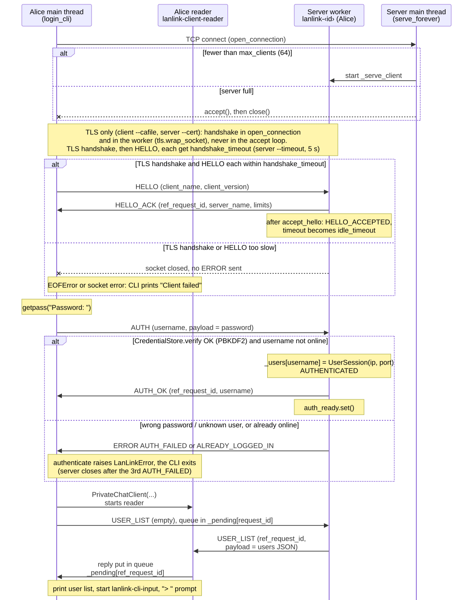
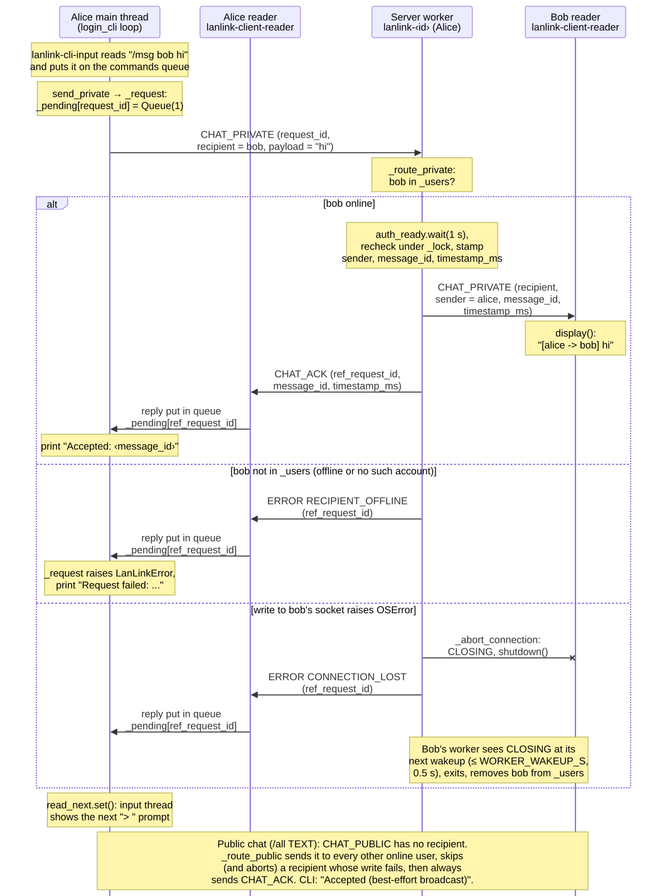
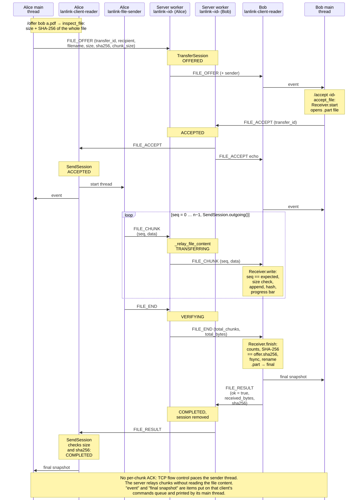
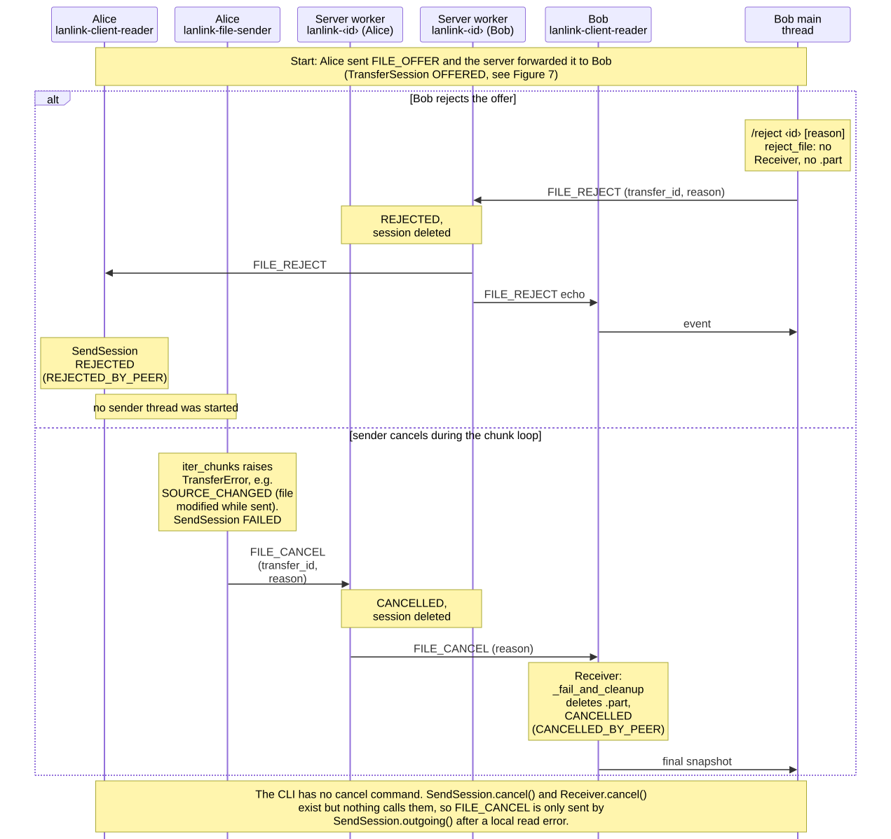
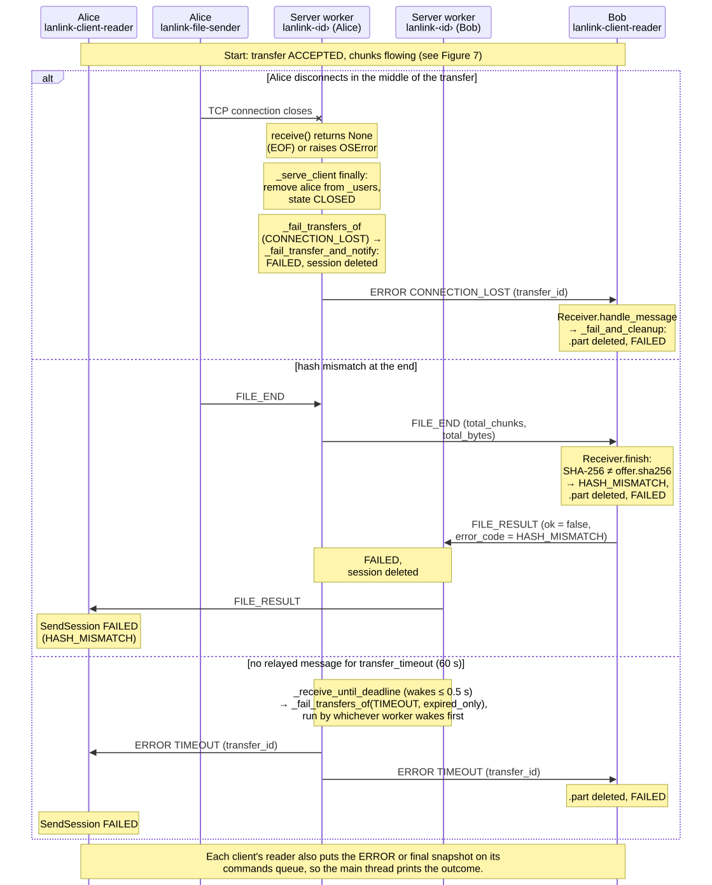

# 3 Sequence Diagrams

This section follows a chat message and a file transfer through the system. In Figures 5
to 9 one lifeline is one thread, not one host. The interface annotations show the CLI:
each CLI client has main, keyboard and reader threads, plus a temporary file sender
(Table 2, Section 1.3.1). The GUI uses the same network messages, with Tk callbacks
instead of typed commands and queued rendering instead of reader-thread printing.
The server has one main accept thread and one worker per client, with no central router
thread. The worker of the connection that
*sent* a message writes the forwarded copy straight into the recipient's socket; a write
lock per socket keeps this frame from interleaving with the recipient worker's own replies.
Error codes are listed in Table 10 (Section 2.5), limits and timeouts in Table 11
(Section 2.6.1), and the connection and transfer states in Figures 3 and 4.

## 3.1 Login and user list

Figure 5 shows how a client connects, logs in and fetches the first user list.

1. The server's main thread accepts the TCP connection and starts a worker for it, or
   closes it at once if 64 connections are already open.
2. With TLS on, the handshake runs in the worker, so a slow client never blocks the accept loop.
3. The client sends `HELLO`, the worker answers `HELLO_ACK`, and the connection becomes
   `HELLO_ACCEPTED`.
4. The client sends `AUTH` with the username in the header and the password in the payload.
5. The worker checks the PBKDF2 hash, registers the session, enters `AUTHENTICATED` and
   replies `AUTH_OK`; only then may other workers forward messages to this client.
6. The client starts its reader thread and asks for `USER_LIST`, which lists every online
   user with IP address and port.

The TLS handshake and `HELLO` each get 5 s; on expiry the server closes the socket without an
`ERROR`. A bad password gets an `ERROR` with `AUTH_FAILED`, and a name already online gets
`ALREADY_LOGGED_IN`. The CLI then exits; the server itself closes a connection after
three failed logins on one connection. The GUI instead shows an English error in the
login window, closes that failed connection and allows another login attempt.

## 3.2 Chat message lifecycle

Figure 6 follows one private message from Alice to Bob using the CLI. In the GUI,
Alice selects Bob's conversation and presses Enter; Bob's reader queues the message
and the Tk thread renders it in that conversation, or increments its unread count.

1. Alice types `/msg bob hi`; her client sends `CHAT_PRIVATE` with a fresh `request_id`
   and `recipient = bob`, and waits for the reply.
2. Alice's server worker finds Bob among the logged-in users and waits up to 1 s until his
   own `AUTH_OK` has been sent.
3. The worker stamps the fields a client may not set: `sender`, a new `message_id` and the
   server's `timestamp_ms`. A client frame that contains them fails with
   `SPOOFED_FIELD` and the connection is closed (2.6.3).
4. The worker writes the stamped message directly into Bob's socket, and Bob's reader thread
   prints it; Bob's server worker is not involved.
5. Only after that write succeeds does the worker send `CHAT_ACK` to Alice, carrying her
   request ID in `ref_request_id` and the server's message ID and timestamp.

`CHAT_ACK` means "written to Bob's connection", not "read by Bob". If Bob has no session,
Alice gets `ERROR RECIPIENT_OFFLINE`. If the write to Bob fails, his stream may hold a partial
frame, so the server shuts his socket down (the worker checks state at read-polling
intervals of at most 0.5 s, not a guaranteed exit time) and answers Alice
with `ERROR CONNECTION_LOST`, as it also does when Bob's `AUTH_OK` is not out within 1 s.

A public message (`/all hi`, type `CHAT_PUBLIC`, no recipient field) is handled differently,
as the note at the bottom of Figure 6 shows. Alice's worker delivers it to each other online
user one by one, closing and skipping any recipient whose write fails. It then always sends
`CHAT_ACK`, even with no recipients, so this ack only means "accepted" (best effort).

## 3.3 File transfer: happy path

Figure 7 shows a successful CLI transfer: negotiation, chunk stream, verification.
In the GUI, the **+** button and file picker replace `/offer`; an Accept/Reject dialog
replaces `/accept` or `/reject`. Both call the same `PrivateChatClient` methods.

1. Alice types `/offer bob a.pdf`; her client reads the file once for its size and SHA-256
   and sends `FILE_OFFER` with these values, the file name and the chunk size.
2. Alice's worker creates a transfer session in state `OFFERED` and forwards the offer to
   Bob with `sender` added.
3. Bob types `/accept <id>`; his client creates a private temporary `.part` file and only
   then sends `FILE_ACCEPT`.
4. Bob's worker moves the session to `ACCEPTED` and forwards the accept to Alice, whose
   reader thread starts a file-sender thread so that the reader stays free.
5. The sender thread sends `FILE_CHUNK` messages of up to 64 KiB with `seq` = 0 … n−1 and
   the raw bytes as payload, then `FILE_END` with the chunk and byte totals.
6. Alice's worker relays each message to Bob without reading the data, moving the session
   to `TRANSFERRING` and then `VERIFYING`.
7. Bob's reader checks each chunk's `seq` and size, appends it to the `.part` file and
   updates a running SHA-256 digest <a href="#ref8">[8]</a>.
8. On `FILE_END`, Bob's client checks the counts and the digest against the offer, flushes
   the file to disk and renames it to its final name in one atomic step.
9. Bob sends `FILE_RESULT` with `ok = true`; his worker marks the session `COMPLETED` and
   forwards it, and Alice's client checks size and hash once more.

There is no per-chunk acknowledgement. TCP already delivers the bytes in order, and its flow
control paces the sender: if Bob reads slowly, the write to his socket blocks Alice's worker,
which stops reading from Alice, whose sender thread then blocks on its own write. Thanks to
the `.part` file and the final rename, an incomplete or corrupt download never appears under
the real name.

## 3.4 File transfer: failure paths

Figure 8 shows the two deliberate stops.

- **Reject.** Bob's `FILE_REJECT` is forwarded to Alice, the session ends `REJECTED`, and no
  file is opened and no sender thread started.
- **Cancel.** Neither interface exposes a cancel control: `FILE_CANCEL` is sent only when reading the
  source fails mid-transfer (e.g. `SOURCE_CHANGED`), and Bob's client then deletes its
  `.part` file and ends `CANCELLED`.

Figure 9 shows the failures nobody chose. In each case the transfer ends `FAILED` and the
receiver deletes its `.part` file.

- **Disconnect.** When either party's connection drops, the server sends the other one an
  `ERROR` with `CONNECTION_LOST` and the transfer ID.
- **Hash mismatch.** If Bob's digest differs from the offer, he sends `FILE_RESULT` with
  `ok = false` and `HASH_MISMATCH`; a wrong `seq` or chunk size fails the same way at once.
- **Timeout.** If no message is relayed for 60 s, the first worker to notice (each wakes at
  least every 0.5 s) sends `ERROR TIMEOUT` to both clients.

## 3.5 Matching replies to requests

Every request carries a fresh `request_id`, and its direct reply, including an `ERROR` it
causes, repeats that value in `ref_request_id`. After login the client keeps one waiting
slot per request and the reader thread fills the slot that matches each reply, so
concurrent requests never get each other's answers. An unmatched reply, or no reply within
5 s, closes the connection, and at most 64 requests can wait at once. Chat, file messages
and errors that name a transfer are not replies. The reader dispatches them to the
transfer code or interface callback: the CLI prints chat directly, while the GUI
queues chat and file/progress events for the Tk thread.
