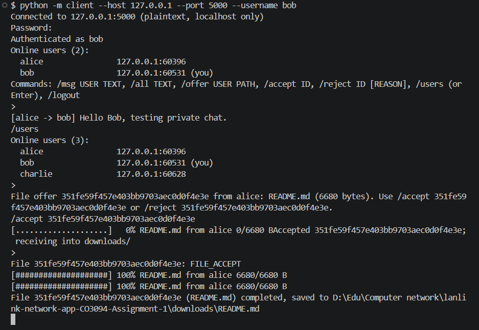
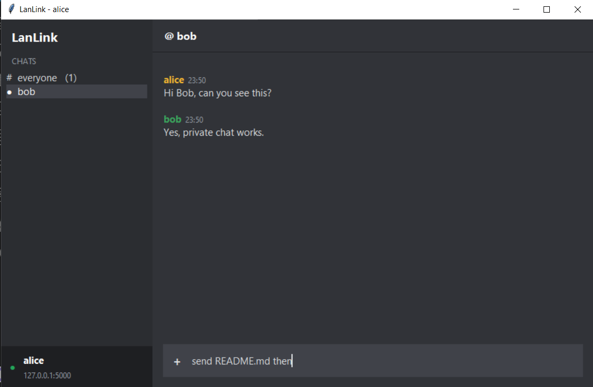
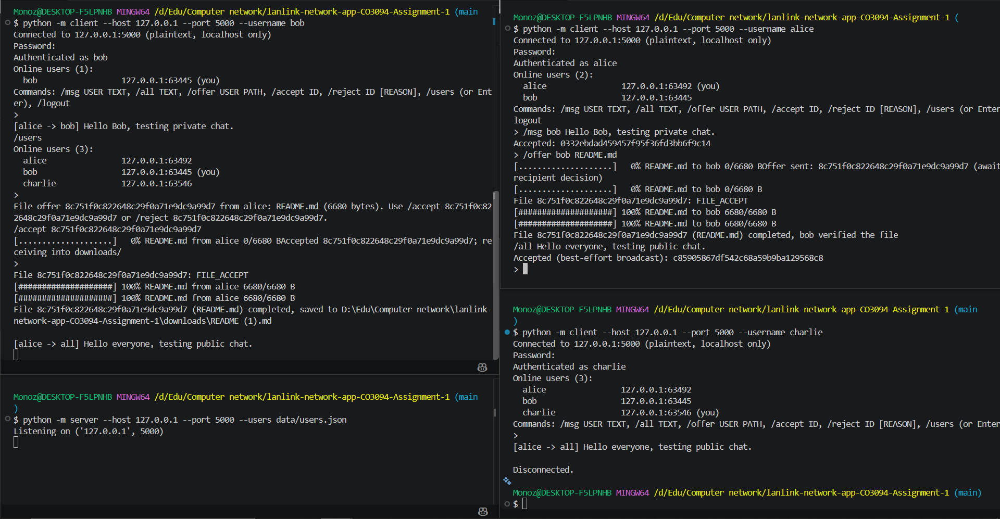
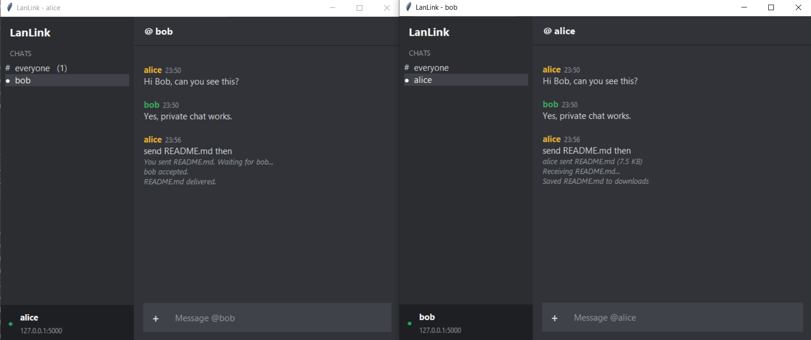

# 5 Testing

## 5.1 Automated tests

The tests run under pytest and otherwise use only the Python standard library, like the application. They cover the frame codec, the file engine, and integration tests that start a real server on the loopback interface and connect real client sockets to it. A run of the 550 tests (counting parametrised cases) on Windows gave 548 passed and 2 skipped; both skipped tests need file-system features that host lacks. The GUI commit adds no automated tests. Shared client logic is covered, but Tk widgets, dialogs and conversation state require separate manual checks. Table 12 summarizes the automated coverage.

Table 12. Test areas.

| Test area | What it checks |
| --- | --- |
| Framing | A stream split at every byte offset decodes to the same frames. |
| Wire format | Golden frames match byte for byte; invalid ones fail with their error code. |
| Concurrency: server | 20 clients connect and send `HELLO` at once; each gets its own worker. |
| Concurrency: one socket | 400 frames written from 4 threads through one connection all arrive whole. |
| Resilience: disconnect | A client that resets its connection is removed; new clients are still accepted. |
| Resilience: forwarding | A failed forward gives the sender `CONNECTION_LOST`; the peer goes offline. |
| Resilience: shutdown | Server shutdown ends every client reader and leaves no users or connections. |
| File integrity | Bad or out-of-order chunks give `HASH_MISMATCH` or `SEQ_MISMATCH`; no file is left. |
| Auth and TLS | A client refuses a server certificate it does not trust. |
| Discovery | Junk datagrams are ignored and `DISCOVER` is still answered. |
| CLI | An incoming message is printed while the client waits for input. |

## 5.2 User interface

LanLink offers a command-line client and an optional Tkinter GUI, both using the same
session and transfer code. Tkinter is part of Python's standard library; Linux systems
may need their distribution's `python3-tk` package.

**CLI.** Figure 10 shows the command-line interface. Incoming chat appears on its own
line as `[sender -> recipient] text`, with `all` for public chat. The user list includes
names, IP addresses and ports, marking the local user with `(you)`. During a transfer,
both sides redraw a line with a bar, percentage, file name, peer and bytes done, for
example `[#####...............]  25% a.txt to bob 256/1024 B`. The commands are:

- `/msg USER TEXT`: private message
- `/all TEXT`: public message
- `/offer USER PATH`: offer a file
- `/accept ID`, `/reject ID [REASON]`: answer an offer
- `/users` or Enter: show the online users
- `/logout` or Ctrl+D: log out



**GUI.** Figure 11 shows the graphical interface. Run `python -m client.gui`.
The login form takes username, password, host and
port, with **Scan LAN**, **Use TLS** and a certificate picker. After login, the sidebar
contains `# everyone` and user conversations with online/offline markers and unread
counts. Each conversation has its own in-memory history; this is not offline message
storage. Enter sends to the selected conversation. The **+** button offers a file;
incoming offers open Accept/Reject dialogs. A shared graphical progress bar appears
after acceptance and remains visible for one second after a terminal snapshot.
The reader queues events; the Tk thread alone updates widgets.



## 5.3 Manual demo

The CLI demo in Figure 12 uses one host and four terminals: create accounts for `alice`, `bob` and `charlie`, start the server in one terminal, and start one client per user in the others (replace `NAME` with the username).

```
python -m server.auth --file data/users.json --username alice
python -m server --host 127.0.0.1 --port 5000 --users data/users.json
python -m client --host 127.0.0.1 --port 5000 --username NAME
```



Figure 13 shows Alice and Bob using two GUI clients connected to the loopback server
at `127.0.0.1:5000`. After exchanging private messages, Alice offers `README.md` and
Bob accepts. Alice's window reports `README.md delivered.`; Bob's reports that the
file was saved to `downloads/`. These completion notices remain after the temporary
progress bar disappears. The screenshot records the happy path; login errors,
discovery and TLS, rejection and disconnect feedback need separate manual checks.
Figures 10 and 12 document the CLI; Figures 11 and 13 document the GUI.


